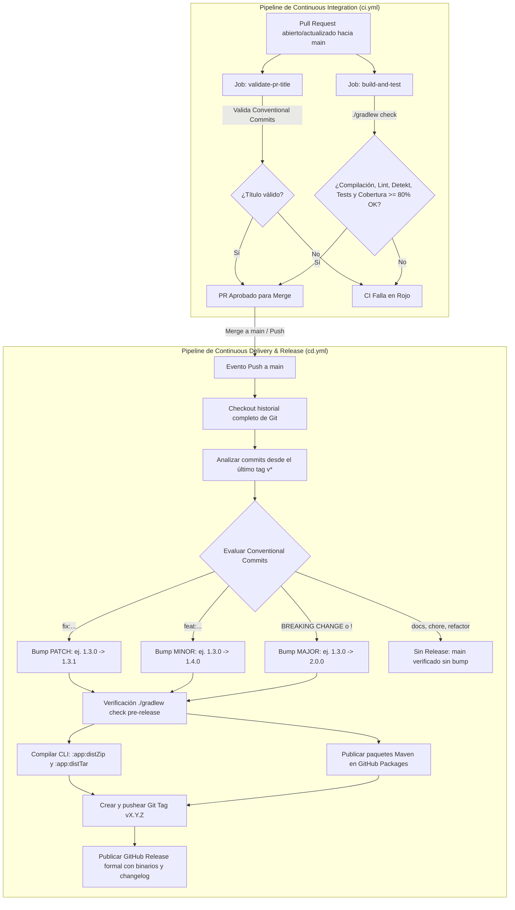

# Arquitectura de CI/CD y Automated Semantic Release

Este documento describe la arquitectura, la filosofía de diseño y la operación técnica de los pipelines de **Continuous Integration (CI)** y **Continuous Delivery / Release (CD)** del proyecto **CNC (PrintScript Engine)**.

---

## 1. Filosofía y Objetivos del Pipeline

El pipeline de CNC se apoya en los principios fundamentales de la ingeniería de software:

1. **La Definición Canónica de CI (Martin Fowler):**
   > *"Continuous Integration es una práctica de desarrollo donde los miembros del equipo integran su trabajo frecuentemente en el mainline, y cada integración es verificada por un build automatizado para detectar errores lo más rápido posible."*
2. **La Regla del Rojo:**
   * El `mainline` es la autopista del código. Si el build se rompe, se detiene la integración y se corrige o revierte de inmediato.
   * `main` debe ser **siempre desplegable**.
3. **Build Once, Deploy Many (Factor V de The Twelve-Factor App):**
   * Separación tajante entre las fases de **Build**, **Release** y **Run**.
   * Los binarios y artefactos se compilan y empaquetan de forma inmutable una sola vez con una versión unívoca.
4. **Cierre de Cadena de Valor (Del TP1 al TP2):**
   * **TP1:** Finaliza proveyendo un motor de lenguaje probado, empaquetado y publicado.
   * **TP2:** Consume los paquetes de PrintScript publicados en **GitHub Packages** como dependencias externas en microservicios Spring Boot.

---

## 2. Diagrama de Flujo del Pipeline



---

## 3. Workflow de CI: [`ci.yml`](../.github/workflows/ci.yml)

### Disparadores
* `pull_request`: hacia `main` ante eventos `opened`, `synchronize`, `reopened`, `edited`.
* `push`: hacia `main`.

### Jobs

#### 1. `validate-pr-title`
* Emplea `amannn/action-semantic-pull-request` para asegurar que el título del PR cumpla con **Conventional Commits**:
  * Formato: `tipo(alcance opcional): descripción en minúsculas`
  * Tipos reconocidos: `feat`, `fix`, `docs`, `style`, `refactor`, `perf`, `test`, `build`, `ci`, `chore`, `revert`.
* **Propósito:** Al realizar un *Squash and Merge* en GitHub, el título del PR se convierte en el commit del mainline, asegurando que el cálculo automático de versión del CD cuente con metadata válida.

#### 2. `build-and-test`
* Ejecuta `./gradlew check --no-daemon --stacktrace` sobre un runner limpio con JDK 21.
* Orquesta de forma monolítica:
  * Compilación Kotlin/Java.
  * Formato con `ktlintCheck`.
  * Análisis estático con `detekt`.
  * Tests unitarios JUnit 5 de los 12 módulos.
  * Verificación de umbral de cobertura **JaCoCo $\ge$ 80%**.
* Publica el resumen de calidad en el `$GITHUB_STEP_SUMMARY` de la ejecución.

---

## 4. Workflow de CD: [`cd.yml`](../.github/workflows/cd.yml)

### Disparadores
* `push`: a la rama `main` (después de mergear un PR).
* `workflow_dispatch`: ejecución manual con selector de bump (`auto`, `patch`, `minor`, `major`).

### Mecanismo de Semantic Versioning Automatizado

El workflow inspecciona los commits acumulados entre el último tag de Git (`vX.Y.Z`) y `HEAD`:

1. **Mayor (`major`):**
   * Disparado por: commits con `BREAKING CHANGE:` en el cuerpo/pie o con `!` en el tipo (ej. `feat!: cambio de contrato`).
   * Cálculo: incrementa el primer dígito y resetea los demás (`1.3.0` $\rightarrow$ `2.0.0`).
2. **Menor (`minor`):**
   * Disparado por: commits que inician con `feat:` o `feat(...):`.
   * Cálculo: incrementa el segundo dígito y resetea el parche (`1.3.0` $\rightarrow$ `1.4.0`).
3. **Parche (`patch`):**
   * Disparado por: commits que inician con `fix:` o `fix(...):`.
   * Cálculo: incrementa el tercer dígito (`1.3.0` $\rightarrow$ `1.3.1`).
4. **Sin Release (`none`):**
   * Si todos los commits son de tipo `docs`, `chore`, `refactor`, `style` o `test`, el workflow determina que no hubo cambios en la API pública de la librería y omite la publicación para evitar polución de versiones vacías.

### Entregables Generados

Cuando se calcula una nueva versión:
1. **Librerías Maven en GitHub Packages:**
   * Cada submódulo de la biblioteca publica su artefacto `.jar` y `.module` en el repositorio Maven de la organización:
     `https://maven.pkg.github.com/TP1-2-INGSIS/CNC`
2. **Distribución Ejecutable de la CLI:**
   * Se generan los archivos `app-<version>.zip` y `app-<version>.tar` en `app/build/distributions/`.
3. **GitHub Release:**
   * Se crea la versión formal en GitHub con el tag `v<version>`, adjuntando los binarios de la CLI y generando automáticamente las notas de release a partir de los PRs y commits integrados.

---

## 5. Consumo de Paquetes desde el TP2 (Snippet Playground)

Para que un microservicio en Spring Boot o un módulo de Kotlin consuma la librería publicada por CNC:

### En `settings.gradle.kts` o `build.gradle.kts` del consumidor:
```kotlin
repositories {
    mavenCentral()
    maven {
        name = "GitHubPackages"
        url = uri("https://maven.pkg.github.com/TP1-2-INGSIS/CNC")
        credentials {
            username = System.getenv("GITHUB_ACTOR") ?: project.findProperty("gpr.user") as? String
            password = System.getenv("GITHUB_TOKEN") ?: project.findProperty("gpr.key") as? String
        }
    }
}
```

### En el bloque `dependencies`:
```kotlin
dependencies {
    // Ejemplo de importación del orquestador de PrintScript
    implementation("com.github.TP1-2-INGSIS:printscript:1.4.0")
}
```
