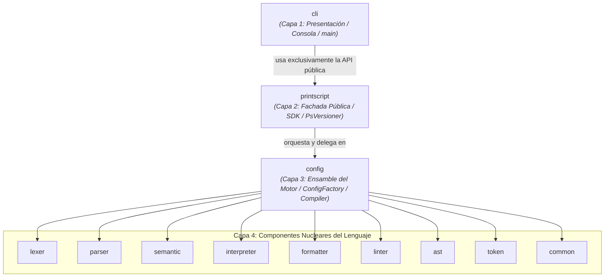

# Propuesta de Refactor 2: Arquitectura en Capas Estricta (`cli` -> `printscript` -> `config` -> Motor)

## 1. Resumen y Diferencia con la Propuesta 1

En la [Propuesta 1 (docs/refactor-config-module.md)](refactor-config-module.md), tanto `:printscript` como `:cli` eran consumidores pares directos del módulo `:config`:
* `printscript` -> `config`
* `cli` -> `config`

En esta **Propuesta 2**, se adopta una **arquitectura en capas estricta (Strict Layered Architecture)**:
* La CLI es tratada como un **cliente externo de primer nivel** (igual que el TCK o un usuario que consuma el SDK vía Maven).
* `:cli` **no conoce** los detalles internos del motor ni el módulo `:config` (`Compiler`, `ConfigFactory`, `LexerConfig`, etc.).
* `:cli` consume exclusivamente la API pública de [`:printscript`](file:///C:/Users/Usuario/Documents/projects/CNC/printscript/src/main/kotlin/cnc/printscript/PrintScript.kt) ([`PsVersioner`](file:///C:/Users/Usuario/Documents/projects/CNC/printscript/src/main/kotlin/cnc/printscript/PsVersioner.kt) y `PrintScriptFacade`).

### Beneficios Clave de este Enfoque
1. **Dogfooding genuino**: El equipo consume y valida su propia API pública (`PrintScriptFacade`) desde la herramienta de consola oficial.
2. **Reutilización absoluta y DRY**: Toda la lógica de lectura de archivos, parseo, validación, linting y formateo ya está centralizada y testeada en `PrintScriptFacade`. Los comandos de la CLI no duplican ni una sola línea de orquestación.
3. **Soporte nativo de versiones en la CLI**: Al usar `PsVersioner.version(...)`, agregar soporte para banderas como `--version=1.0` o `--version=1.1` en la consola se resuelve en una sola línea.
4. **Desacoplamiento total**: Si mañana cambia la forma interna en que se ensambla el motor (`config`), la CLI no sufre ningún impacto siempre que el contrato público (`printscript`) se mantenga estable.

---

## 2. Mapa Arquitectónico en Capas



---

## 3. Detalle de Implementación Módulo por Módulo

### A. Raíz del Proyecto

#### `settings.gradle.kts`
Se elimina `:app` y se incorpora `:config`:
```kotlin
include(
-   "app",
    "ast",
    "cli",
    "lexer",
    "token",
    "parser",
    "common",
    "interpreter",
    "formatter",
    "semantic",
    "linter",
    "printscript",
+   "config"
)
```

---

### B. Módulo `:config` (El Ensamble del Motor)

Ubicación: raíz del repositorio en la carpeta `config/`.

#### 1. `config/build.gradle.kts`
```kotlin
plugins {
    `java-library`
    alias(libs.plugins.kotlin.jvm)
    id("jacoco-conventions")
}

repositories {
    mavenCentral()
}

java {
    toolchain {
        languageVersion = JavaLanguageVersion.of(21)
    }
}

dependencies {
    api(project(":common"))
    api(project(":token"))
    api(project(":ast"))
    api(project(":lexer"))
    api(project(":parser"))
    api(project(":semantic"))
    api(project(":interpreter"))
    api(project(":formatter"))
    api(project(":linter"))

    implementation(libs.guava)
    implementation(libs.gson)

    testImplementation("org.jetbrains.kotlin:kotlin-test")
    testImplementation(libs.junit.jupiter.engine)
    testRuntimeOnly("org.junit.platform:junit-platform-launcher")
}

tasks.named<Test>("test") {
    useJUnitPlatform()
}
```

#### 2. Clases que contiene:
* **`cnc/Config.kt`**: `data class Config` y `data class Compiler`.
* **`cnc/config/`**:
  * `ConfigFactory.kt`
  * `LanguageVersion.kt`
  * `FormatterFactory.kt` y `Formatter.kt`
  * `InterpreterConfig.kt`
  * `LexerConfig.kt`
  * `ParserConfig.kt`
  * `SemanticConfig.kt`
  * `Tokens.kt`

---

### C. Módulo `:printscript` (Fachada y Punto Único de Contacto)

#### 1. `printscript/build.gradle.kts`
Reemplaza `:app` por `:config`:
```kotlin
dependencies {
    api(project(":common"))
    api(project(":token"))
    api(project(":ast"))
    api(project(":lexer"))
    api(project(":parser"))
    api(project(":semantic"))
    api(project(":interpreter"))
    api(project(":formatter"))
    api(project(":linter"))
-   api(project(":app"))
+   api(project(":config"))

    testImplementation("org.jetbrains.kotlin:kotlin-test")
    testImplementation(libs.junit.jupiter.engine)
    testRuntimeOnly("org.junit.platform:junit-platform-launcher")
}
```

#### 2. Capacidades expuestas a la CLI:
`PrintScriptFacade` ya expone todas las operaciones que la consola necesita:
* `execute(file: File): Result<Unit>`
* `validate(file: File): Result<Unit>`
* `format(file: File, configJson: String?): String`
* `lint(file: File, configFile: File): List<String>`

---

### D. Módulo `:cli` (Consumidor de `:printscript` y Ejecutable)

#### 1. `cli/build.gradle.kts`
Depende de `:printscript` (y no de `:config`). Se activa el plugin `application`:
```kotlin
plugins {
    alias(libs.plugins.kotlin.jvm)
+   application
    id("jacoco-conventions")
}

repositories {
    mavenCentral()
}

java {
    toolchain {
        languageVersion = JavaLanguageVersion.of(21)
    }
}

dependencies {
    testImplementation("org.jetbrains.kotlin:kotlin-test")
    testImplementation(libs.junit.jupiter.engine)
    testRuntimeOnly("org.junit.platform:junit-platform-launcher")

    implementation(libs.guava)
    implementation(project(":common"))
+   implementation(project(":printscript")) // <-- Depende de la fachada pública
}

+application {
+    mainClass = "cnc.cli.CliKt"
+}

+tasks.named<JavaExec>("run") {
+    standardInput = System.`in`
+}

tasks.named<Test>("test") {
    useJUnitPlatform()
}
```

#### 2. Comandos CLI reimplementados sobre la Fachada

Al delegar en `PrintScriptFacade`, el código de los comandos se vuelve trivial, robusto y admite versión por parámetro:

```kotlin
package cnc.cli.command

import java.io.File
import cnc.cli.args.ArgsContainer
import cnc.common.ErrorType
import cnc.common.Failure
import cnc.common.Result
import cnc.common.Success
import cnc.printscript.PsVersioner

// 1. Comando RUN
object RunCommand : Command {
    override val tag = "run"

    override fun execute(params: ArgsContainer): Result<Unit> {
        val filePath = params.getOption("file") ?: params.getPositional(0)
            ?: return Failure("Missing required source file. Usage: run <file> [--version=1.1]", ErrorType.CLI)

        val version = params.getOption("version") ?: "1.1"
        val engine = try {
            PsVersioner.version(version)
        } catch (e: Exception) {
            return Failure(e.message ?: "Invalid version", ErrorType.CLI)
        }

        return engine.execute(File(filePath))
    }
}

// 2. Comando VALIDATE
object ValidateCommand : Command {
    override val tag = "validate"

    override fun execute(params: ArgsContainer): Result<Unit> {
        val filePath = params.getOption("file") ?: params.getPositional(0)
            ?: return Failure("Missing required source file. Usage: validate <file> [--version=1.1]", ErrorType.CLI)

        val version = params.getOption("version") ?: "1.1"
        val engine = try {
            PsVersioner.version(version)
        } catch (e: Exception) {
            return Failure(e.message ?: "Invalid version", ErrorType.CLI)
        }

        return engine.validate(File(filePath))
    }
}

// 3. Comando FORMAT
object FormatCommand : Command {
    override val tag = "format"

    override fun execute(params: ArgsContainer): Result<Unit> {
        val filePath = params.getOption("file") ?: params.getPositional(0)
            ?: return Failure("Missing required source file. Usage: format <file> [--config=<path>]", ErrorType.CLI)

        val configPath = params.getOption("config")
        val configJson = configPath?.let { File(it).readText() }

        val version = params.getOption("version") ?: "1.1"
        val engine = PsVersioner.version(version)

        return runCatching {
            engine.format(File(filePath), configJson)
        }.fold(
            onSuccess = { formatted -> Success(formatted, Unit) },
            onFailure = { e -> Failure(e.message ?: "Formatting failed", ErrorType.CLI) }
        )
    }
}
```

#### 3. Punto de Entrada `main()`
En `cli/src/main/kotlin/cnc/cli/Cli.kt`:
```kotlin
val CLISystem = CommandSystem(mapOf(
    RunCommand.tag to RunWithHelp,
    ValidateCommand.tag to ValidateWithHelp,
    FormatCommand.tag to FormatWithHelp,
    GccCommand.tag to GCNCWithHelp
))

fun main() {
    CLISystem.run()
}
```

---

### E. Eliminación de `:app`
Se borra la carpeta `app/` por completo.

---

### F. CI/CD y Documentación
* En `.github/workflows/cd.yml`: cambiar `:app:distZip` por `:cli:distZip` y las rutas `app/build/distributions/*` por `cli/build/distributions/*`.
* En `README.md` y `docs/development.md`: actualizar `./gradlew :app:run` a `./gradlew :cli:run`.

---

## 4. Comparativa: Propuesta 1 vs. Propuesta 2

| Criterio | Propuesta 1 (`cli` y `printscript` usan `config`) | Propuesta 2 (`cli` usa `printscript`) |
| :--- | :--- | :--- |
| **Relación de dependencias** | Bifurcada: `cli -> config`, `printscript -> config` | Lineal y pura: `cli -> printscript -> config -> motor` |
| **Conocimiento de la CLI** | `cli` conoce `ConfigFactory`, `Compiler`, `Lexer`, `Parser` | `cli` solo conoce `PrintScriptFacade` y `PsVersioner` |
| **Lógica de comandos CLI** | La CLI instancia compiladores y orquesta tokens/AST a mano | La CLI delega todo en 1 línea al método de la fachada |
| **Dogfooding** | No prueba la fachada `printscript` internamente | Prueba y valida la fachada pública en cada comando |
| **Soporte de `--version`** | Requiere cablear factories en cada comando | Directo con `PsVersioner.version(v)` |

---

## 5. Comandos de Verificación

```bash
# Compilar todo el proyecto y correr tests unitarios
./gradlew test

# Chequeo estricto de cobertura JaCoCo (>= 80%) y linters
./gradlew check

# Probar ejecución del CLI interactivo
./gradlew :cli:run

# Probar empaquetado del distribuible CD
./gradlew :cli:distZip
```
