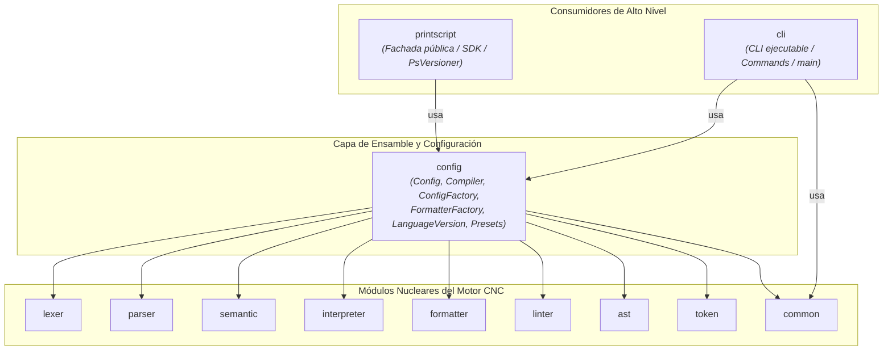

# Propuesta de Refactor: Módulo `:config`, Eliminación de `:app` y Desacoplamiento de `:printscript`

## 1. Resumen Ejecutivo y Motivación

Actualmente el proyecto presenta un antipatrón arquitectónico de **inversión de dependencias**:
* El módulo `:printscript` (que es el SDK / fachada pública publicado para librerías y el TCK) depende directamente de `:app` (`api(project(":app"))`).
* El módulo `:app` acumula dos responsabilidades que no le corresponden:
  1. El **ensamble del motor**: toda la configuración de versiones (`LanguageVersion`), presets (`LexerConfig`, `ParserConfig`, `InterpreterConfig`, `SemanticConfig`), fábricas (`ConfigFactory`, `FormatterFactory`) y orquestadores (`Config`, `Compiler`).
  2. Los comandos de consola (`RunCommand`, `ValidateCommand`, `FormatCommand`) mezclados en el paquete `cnc.config`.
* Al mismo tiempo, `:cli` ya existe en el proyecto como módulo independiente de línea de comandos, dejando a `:app` reducido únicamente a un `main()` redundante.

### Objetivos del Refactor
1. **Crear el módulo `:config`**: encapsula el ensamble del motor (conocimiento de cómo combinar e instanciar cada versión de PrintScript `1.0` y `1.1`).
2. **Posicionar `:printscript` como la fachada superior (SDK)**: consume `:config` para presentar una API ergonómica (`PrintScriptFacade`, `PsVersioner`) sin depender de ningún ejecutable ni de `:app`.
3. **Mover la lógica de CLI a `:cli`**: `:cli` consume `:config` para ejecutar comandos y asume el rol de ejecutable de consola (`application` plugin con `main()`).
4. **Eliminar `:app` por completo**: se remueve el subproyecto y su carpeta, eliminando código duplicado e innecesario.

---

## 2. Mapa Arquitectónico y Grafo de Dependencias



---

## 3. Detalle Exhaustivo de Cambios Módulo por Módulo

### A. Raíz del Proyecto

#### 1. `settings.gradle.kts`
Se da de baja el módulo `app` y se da de alta el módulo `config`:
```kotlin
include(
-   "app",
    "ast",
    "cli",
    "lexer",
    "token",
    "parser",
    "common",
    "interpreter",
    "formatter",
    "semantic",
    "linter",
    "printscript",
+   "config"
)
```

---

### B. Nuevo Módulo: `:config` (El Ensamble del Motor)

Ubicación: raíz del repositorio en la carpeta `config/` existente.

#### 1. `config/build.gradle.kts` (Nuevo archivo)
```kotlin
plugins {
    `java-library`
    alias(libs.plugins.kotlin.jvm)
    id("jacoco-conventions")
}

repositories {
    mavenCentral()
}

java {
    toolchain {
        languageVersion = JavaLanguageVersion.of(21)
    }
}

dependencies {
    // Expone los contratos y módulos que ensambla a sus consumidores (printscript y cli)
    api(project(":common"))
    api(project(":token"))
    api(project(":ast"))
    api(project(":lexer"))
    api(project(":parser"))
    api(project(":semantic"))
    api(project(":interpreter"))
    api(project(":formatter"))
    api(project(":linter"))

    implementation(libs.guava)
    implementation(libs.gson)

    testImplementation("org.jetbrains.kotlin:kotlin-test")
    testImplementation(libs.junit.jupiter.engine)
    testRuntimeOnly("org.junit.platform:junit-platform-launcher")
}

tasks.named<Test>("test") {
    useJUnitPlatform()
}
```

#### 2. Archivos Kotlin en `config/src/main/kotlin/`:

* **`cnc/Config.kt`** (Extraído de `app/src/main/kotlin/cnc/app.kt`):
  * `data class Config(...)`
  * `data class Compiler(val config: Config) { ... }`
  * Paquete: `package cnc`

* **`cnc/config/`** (Movidos desde `app/src/main/kotlin/cnc/config/` sin cambios internos de paquete):
  * `ConfigFactory.kt` (ensambla los motores según `LanguageVersion`)
  * `LanguageVersion.kt` (enum de versiones de lenguaje `1.0`, `1.1` y parser)
  * `FormatterFactory.kt` (fábrica de formateadores y parsing de JSON)
  * `Formatter.kt` (presets de formato)
  * `InterpreterConfig.kt` (presets de intérprete)
  * `LexerConfig.kt` (presets de lexer para 1.0 y 1.1)
  * `ParserConfig.kt` (presets de parser para 1.0 y 1.1)
  * `SemanticConfig.kt` (presets de análisis semántico)
  * `Tokens.kt` (listas de definiciones de tokens)

---

### C. Módulo `:printscript` (La Fachada / SDK Público)

#### 1. `printscript/build.gradle.kts`
Se reemplaza la dependencia a `:app` por la dependencia limpia a `:config`:
```kotlin
dependencies {
    api(project(":common"))
    api(project(":token"))
    api(project(":ast"))
    api(project(":lexer"))
    api(project(":parser"))
    api(project(":semantic"))
    api(project(":interpreter"))
    api(project(":formatter"))
    api(project(":linter"))
-   api(project(":app"))
+   api(project(":config"))

    testImplementation("org.jetbrains.kotlin:kotlin-test")
    testImplementation(libs.junit.jupiter.engine)
    testRuntimeOnly("org.junit.platform:junit-platform-launcher")
}
```

#### 2. Código fuente (`PrintScript.kt` y `PsVersioner.kt`)
* **Cero cambios necesarios**: Las clases importadas (`Config`, `Compiler`, `ConfigFactory`, `LanguageVersion`, `FormatterFactory`) conservan los paquetes `cnc` y `cnc.config`, provistos ahora por `:config`.

---

### D. Módulo `:cli` (Interfaz de Comandos y Ejecutable)

#### 1. `cli/build.gradle.kts`
Se habilita el plugin `application`, se configura el `mainClass` y se agrega la dependencia a `:config`:
```kotlin
plugins {
    alias(libs.plugins.kotlin.jvm)
+   application
    id("jacoco-conventions")
}

repositories {
    mavenCentral()
}

java {
    toolchain {
        languageVersion = JavaLanguageVersion.of(21)
    }
}

dependencies {
    testImplementation("org.jetbrains.kotlin:kotlin-test")
    testImplementation(libs.junit.jupiter.engine)
    testRuntimeOnly("org.junit.platform:junit-platform-launcher")

    implementation(libs.guava)
    implementation(project(":common"))
+   implementation(project(":config"))
}

+application {
+    mainClass = "cnc.cli.CliKt"
+}

+tasks.named<JavaExec>("run") {
+    standardInput = System.`in`
+}

tasks.named<Test>("test") {
    useJUnitPlatform()
}
```

#### 2. Archivos en `cli/src/main/kotlin/cnc/cli/`:
* **`cli/src/main/kotlin/cnc/cli/Cli.kt`** (o `cli.kt`):
  * Se trasladan `CLISystem` y los comandos PrintScript (`RunCommand`, `ValidateCommand`, `GccCommand`, `FormatCommand`) desde `app`.
  * Se incorpora la función de entrada principal:
    ```kotlin
    fun main() {
        CLISystem.run()
    }
    ```

---

### E. Eliminación del Módulo `:app`

* Se elimina el directorio completo `app/` del sistema de archivos.

---

### F. CI/CD y Documentación

#### 1. `.github/workflows/cd.yml`
Se redirige la generación de artefactos distribuibles `.zip` y `.tar` hacia `:cli`:
```yaml
- name: Build distribution
- run: ./gradlew :app:distZip :app:distTar --no-daemon --stacktrace
+ run: ./gradlew :cli:distZip :cli:distTar --no-daemon --stacktrace

- name: Upload distribution artifact
  uses: actions/upload-artifact@v4
  with:
    name: cnc-distribution
-   path: app/build/distributions/*
+   path: cli/build/distributions/*
    if-no-files-found: error

- name: Publish GitHub Release
  if: startsWith(github.ref, 'refs/tags/v')
  uses: softprops/action-gh-release@v2
  with:
-   files: app/build/distributions/*
+   files: cli/build/distributions/*
    generate_release_notes: true
```

#### 2. `README.md` y `docs/development.md`
Actualizar la instrucción de ejecución:
```bash
# Antes
./gradlew :app:run

# Ahora
./gradlew :cli:run
```

---

## 4. Matriz Comparativa Antes vs. Después

| Aspecto | Antes | Después |
| :--- | :--- | :--- |
| **Rol de `config`** | Carpeta secundaria en raíz solo con `detekt.yml` | Submódulo Gradle central responsable de todo el ensamble del motor |
| **Dependencia de `printscript`** | Depende de `:app` (antipatrón de inversión) | Depende de `:config` (limpio y modular) |
| **Rol de `cli`** | Solo librería con clases base de CLI sin los comandos de PrintScript | Aplicación completa con comandos y punto de entrada `main()` |
| **Rol de `app`** | Módulo inflado con configs y comandos mezclados | **Eliminado** |
| **Ejecución local** | `./gradlew :app:run` | `./gradlew :cli:run` |
| **Generación de binarios CD** | `:app:distZip` | `:cli:distZip` |

---

## 5. Plan de Verificación

Una vez aplicados los cambios, los siguientes comandos garantizan el 100% de integridad:

```bash
# 1. Compilación y suite completa de tests de todos los submódulos
./gradlew test

# 2. Verificación de cobertura JaCoCo (mínimo 80%) y linters
./gradlew check

# 3. Verificación de ejecución del CLI interactivo
./gradlew :cli:run

# 4. Verificación de packaging para release de CD
./gradlew :cli:distZip
```
