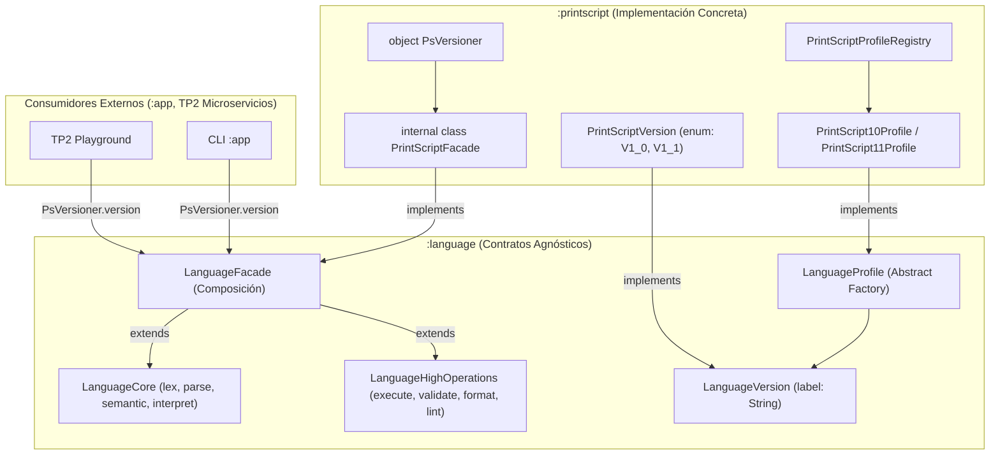

# Reporte Técnico: Auditoría de Arquitectura del PR #86 (Language Module & Facade Reduction)

**Fecha:** 2026-10-19  
**Pull Request:** [#86](https://github.com/TP1-2-INGSIS/CNC/pull/86) — *feat: implemented Language module with a reduced LanguageFacade, profile and versioning interfaces*  
**Rama Origen:** `85-fix-reduce-languagefacade-interface` hacia `main`  
**Autor:** Juan José Seré (`QchuDev`)  
**Ubicación:** `docs/reports/2026-10-19_pr-86_language-facade-audit.md`  

---

## 1. Resumen Ejecutivo y Alcance

El Pull Request #86 aborda un problema crítico de diseño que arrastraba el proyecto: **la explosión combinatoria de sobrecargas en la fachada del motor (`PrintScriptFacade`)**. En la versión actual de `main`, la fachada contenía más de 30 métodos redundantes que sobrecargaban `String`, `File`, `InputStream` y `ContentManager` para cada fase del pipeline (`lex`, `parse`, `semantic`, `interpret`, `validate`, `format`, `lint`).

El autor propone:
1. Crear un submódulo desacoplado llamado `:language` con interfaces agnósticas a PrintScript (`LanguageCore`, `LanguageHighOperations`, `LanguageFacade`, `LanguageProfile`, `LanguageVersion`).
2. Reducir la interfaz pública a una única firma canónica basada en `ContentManager`.
3. Renombrar e implementar perfiles por versión mediante `PrintScriptProfileRegistry` y `PsVersioner`.

### Veredicto Global: Favorable con Observaciones Menores
El PR avanza en un **80% en la dirección correcta** según nuestra filosofía de diseño: elimina cientos de líneas de boilerplate, respeta el principio de segregación de interfaces (**ISP**) y aplica inversión de dependencias (**DIP**). No obstante, introduce **4 puntos ciegos** que degradan la experiencia de uso (DX) y la seguridad de tipos, los cuales deben corregirse antes de su integración a `main`.

---

## 2. Radiografía: Propuesta de PR #86 vs. Filosofía del Proyecto

| Dimensión Arquitectónica | Estado en `main` | Propuesta en PR #86 | Filosofía del Proyecto (`Agent Context`) | Evaluación / Severidad |
| :--- | :--- | :--- | :--- | :--- |
| **Segregación de Interfaces (ISP)** | Fachada monolítica de 50+ métodos. | Separa `LanguageCore` (granular) de `LanguageHighOperations` (end-to-end). | Promover interfaces específicas y cohesivas. Composición sobre herencia. | **Excelente** :white_check_mark: |
| **Eliminación de Boilerplate (DRY)** | Sobrecargas combinatorias para cada tipo de entrada. | Firma única recibiendo `ContentManager`. | Eliminar código redundante y capas intermedias artificiales. | **Muy Buena** :white_check_mark: |
| **Developer Experience (DX)** | Llamada directa con `String` o `File`. | **Obliga** a instanciar `StringContent("...")` o `FileContent(...)`. | *"Out of the box": instanciar y usar en una línea sin lidiar con clases internas*. | **Falla (DX degradada)** :warning: |
| **Seguridad de Tipos (Type-Safety)** | `PsVersioner.version("1.1")` vía String. | Se mantiene `PsVersioner.version(String)` retornando `LanguageFacade`. | *Prohibido el tipado débil o dispatch ciego por strings: errores en compilación, no en runtime.* | **Falla (Antipatrón)** :warning: |
| **Evaluación Perezosa (Streaming)** | Inconsistente entre submódulos. | `execute()` hace streaming real; `LanguageCore` retorna `List<Statement>`. | Pipeline en streaming con huella de memoria $O(1)$. | **Mejorable** :large_yellow_circle: |
| **Acoplamiento de Build** | `:printscript` agrupa todo. | Nuevo submódulo `:language` con 9 dependencias `api`. | Modularidad justificada sin sobre-ingeniería de grafo. | **Aceptable / Discutible** :large_yellow_circle: |

---

## 3. Diagrama de la Nueva Arquitectura



---

## 4. Análisis Detallado de los 4 Puntos Críticos

### Punto 1: Degradación de la Developer Experience (DX) por falta de Extension Functions
* **Problema:** En el intento de podar la interfaz, se eliminó la posibilidad de que el llamador pase directamente un `String` o un `File`. Ahora el código cliente se ve obligado a importar y construir envolturas:
  ```kotlin
  // Inconveniente para el consumidor externo:
  val result = ps.execute(StringContent(sourceCode))
  val formatted = ps.format(StringContent(sourceCode))
  ```
* **Solución de Ingeniería Idiomática:**
  El contrato de la interfaz (`LanguageFacade`) debe mantenerse mínimo recibiendo `ContentManager`, pero deben proveerse **Extension Functions** de Kotlin para recuperar la ergonomía:
  ```kotlin
  fun LanguageFacade.execute(code: String, ...) = execute(StringContent(code), ...)
  fun LanguageFacade.execute(file: File, ...) = execute(FileContent(file.absolutePath), ...)
  fun LanguageFacade.format(code: String, configJson: String? = null) = format(StringContent(code), configJson)
  fun LanguageFacade.validate(code: String) = validate(StringContent(code))
  ```

---

### Punto 2: Dispatch Débil por String en `PsVersioner`
* **Problema:** `PsVersioner.version(version: String)` traslada un error sintáctico de versión al tiempo de ejecución:
  ```kotlin
  val ps = PsVersioner.version("1.2") // Lanza UnsupportedVersionException en runtime
  ```
* **Solución de Ingeniería:**
  Mantener la sobrecarga con `String` para la CLI (que lee argumentos de terminal), pero incorporar como método primario la variante fuertemente tipada:
  ```kotlin
  object PsVersioner {
      fun version(version: PrintScriptVersion): LanguageFacade = PrintScriptFacade(version)
      fun version(version: String): LanguageFacade = version(PrintScriptVersion.from(version))
  }
  ```
  O mediante factorías explícitas: `PrintScriptEngine.v1_0()` / `PrintScriptEngine.v1_1()`.

---

### Punto 3: Pérdida del Streaming Perezoso en `LanguageCore`
* **Problema:** En `LanguageCore`:
  ```kotlin
  fun parse(tokens: Sequence<Token>): Result<List<Statement>>
  fun semantic(statements: List<Statement>): Result<List<Statement>>
  ```
  Obliga a materializar listas completas en memoria. Aunque `execute()` orquesta internamente un bucle statement-por-statement, si un usuario (o el TCK) consume las etapas granulares por separado, se pierde el desacoplamiento de streaming perezoso.
* **Solución:** Evaluar si `parse` y `semantic` pueden emitir `Sequence<Statement>` o `Sequence<Result<Statement>>`.

---

### Punto 4: Trade-off del Submódulo `:language`
* **Problema:** `:language` solo contiene 3 archivos de interfaces (~100 líneas), pero declara 9 dependencias `api`.
* **Balance:** Si bien añade un módulo más al proyecto (13 en total), documenta formalmente la arquitectura para la defensa oral y separa tajantemente el "framework para lenguajes" del "lenguaje PrintScript en sí". Se considera aceptable siempre que no genere ciclos ni fricción de compilación.

---

## 5. Plan de Acción y Recomendaciones para la Review en GitHub

1. **Revisión Punto por Punto con el equipo (Punto 1 $\rightarrow$ Punto 4).**
2. **Dejar comentarios constructivos en GitHub destacando los logros y sugiriendo:**
   * La inclusión de Extension Functions para proteger la DX.
   * La sobrecarga tipada en `PsVersioner`.
3. **Aprobar el PR una vez incorporadas las mejoras ergonómicas.**
