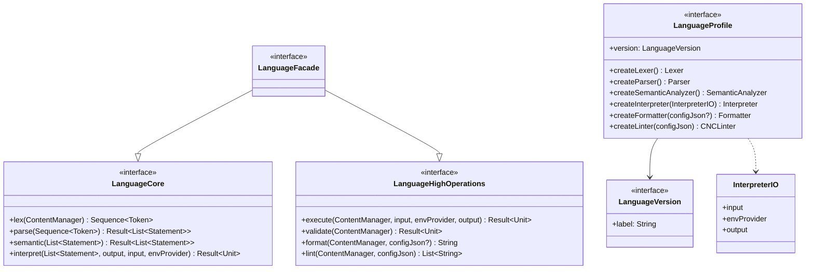

# Módulo: :language

**Ruta:** `/language`
**Dependencias directas (`api`):** `:common`, `:token`, `:ast`, `:lexer`, `:parser`, `:semantic`, `:interpreter`, `:formatter`, `:linter`
**Consumidores:** `:printscript` (y transitivamente `:app`)

---

## 1. Responsabilidad y Propósito (SRP)
- **Qué problema resuelve:** Define los contratos agnósticos que cualquier lenguaje construido sobre CNC debe cumplir: cómo se exponen sus operaciones (fachadas), cómo se ensamblan los componentes del pipeline (perfil) y cómo se identifica una versión.
- **Qué hace:**
  - Declara las etapas granulares del pipeline en `LanguageCore` (`lex`, `parse`, `semantic`, `interpret`).
  - Declara las operaciones end-to-end en `LanguageHighOperations` (`execute`, `validate`, `format`, `lint`).
  - Compone ambas en la fachada pública `LanguageFacade`.
  - Define `LanguageProfile`, la fábrica de componentes (lexer, parser, semantic, interpreter, formatter, linter) de una versión del lenguaje, junto con `InterpreterIO` (canales de I/O inyectables).
  - Define `LanguageVersion` como interfaz mínima (`label`).
- **Qué NO hace (Fronteras):**
  - No contiene implementaciones ni conoce ningún lenguaje concreto: las versiones (`PrintScriptVersion`), perfiles (`PrintScript10Profile`, `PrintScript11Profile`), registry y motor (`PrintScriptEngine`) viven en `:printscript`.
  - No resuelve versiones desde texto ni lanza errores de versión no soportada (responsabilidad de cada lenguaje).

---

## 2. Arquitectura y Componentes Clave

### Diagrama de Contratos


### Entidades de Dominio e Interfaces
1. **`LanguageCore`:** Etapas granulares. Cada una consume la salida de la anterior: `ContentManager → Sequence<Token> → List<Statement>`.
2. **`LanguageHighOperations`:** Operaciones de un solo llamado sobre una fuente (`ContentManager`).
3. **`LanguageFacade`:** Contrato público unificado (`LanguageCore` + `LanguageHighOperations`). Un consumidor que solo necesita una de las dos caras puede depender de la interfaz segregada.
4. **`LanguageProfile`:** Fábrica por versión. Definir una versión nueva del lenguaje = implementar un perfil.
5. **`LanguageVersion`:** Identificador de versión. Cada lenguaje lo implementa típicamente con un `enum`.
6. **`InterpreterIO`:** `data class` con los canales `input`, `envProvider` y `output` inyectados en los builtins del intérprete.

---

## 3. Manejo de Errores y Pipeline Funcional
- Todas las operaciones que pueden fallar retornan `Result<T>` (`:common`); el módulo no define excepciones propias.
- `format` retorna `String` y `lint` retorna `List<String>` (advertencias; lista vacía = sin observaciones).

---

## 4. Ejemplo Práctico Autónomo (End-to-End)

```kotlin
package example

import cnc.common.StringContent
import cnc.formatter.Formatter
import cnc.formatter.FormatterFactory
import cnc.interpreter.Interpreter
import cnc.language.InterpreterIO
import cnc.language.LanguageProfile
import cnc.language.LanguageVersion
import cnc.lexer.Lexer
import cnc.linter.CNCLinter
import cnc.parser.Parser
import cnc.semantic.SemanticAnalyzer

// 1. Versiones del lenguaje nuevo
enum class MyLangVersion(override val label: String) : LanguageVersion {
    V1("1.0"),
}

// 2. Perfil: ensambla los componentes del pipeline para esa versión
object MyLang1Profile : LanguageProfile {
    override val version: LanguageVersion = MyLangVersion.V1
    override fun createLexer(): Lexer = TODO("reglas léxicas")
    override fun createParser(): Parser = TODO("reglas sintácticas")
    override fun createSemanticAnalyzer(): SemanticAnalyzer = TODO("validadores")
    override fun createInterpreter(io: InterpreterIO): Interpreter = TODO("evaluadores + builtins")
    override fun createFormatter(configJson: String?): Formatter = FormatterFactory.create(configJson)
    override fun createLinter(configJson: String): CNCLinter = CNCLinter(emptyList())
}

// 3. Uso a través de la fachada (implementada por el motor del lenguaje, ej: PrintScriptEngine)
fun run(facade: cnc.language.LanguageFacade) {
    val content = StringContent("let x: number = 1; println(x);")
    facade.execute(content, output = { println("OUT: $it") })

    val tokens = facade.lex(content)          // etapas granulares
    val ast = facade.parse(tokens)
}
```

---

## 5. Integración en el Pipeline del Compilador
- **Entrada:** `ContentManager` (`StringContent`, `FileContent`, `InputStreamContent`) para `lex` y las operaciones de alto nivel; `Sequence<Token>` / `List<Statement>` para las etapas granulares siguientes.
- **Implementación:** `:printscript` provee `PrintScriptEngine : LanguageFacade`, que resuelve su `LanguageProfile` desde `PrintScriptProfileRegistry` según la `PrintScriptVersion`.

---

## 6. Decisiones Técnicas y Tradeoffs
- **Una firma por operación:** Se eliminaron las sobrecargas por tipo de entrada (`String`, `File`, `InputStream`): el llamador envuelve la fuente en un `ContentManager`. Contrato más chico y sin métodos que solo traducen tipos.
- **Segregación de interfaces (ISP):** `LanguageCore` y `LanguageHighOperations` separan el uso granular del end-to-end; `LanguageFacade` las compone.
- **`LanguageVersion` como interfaz:** El módulo no conoce versiones concretas; cada lenguaje define las suyas, manteniendo `:language` agnóstico.
- **Dependencias `api`:** Las firmas públicas exponen tipos de `:lexer`, `:parser`, `:semantic`, etc., por lo que se propagan transitivamente a los consumidores.
- **`jvmDefault = NO_COMPATIBILITY`:** Los parámetros por defecto de las interfaces se compilan como métodos default de la JVM, sin generar clases `DefaultImpls`. Los consumidores son Kotlin; un consumidor Java debería pasar todos los argumentos explícitamente.
