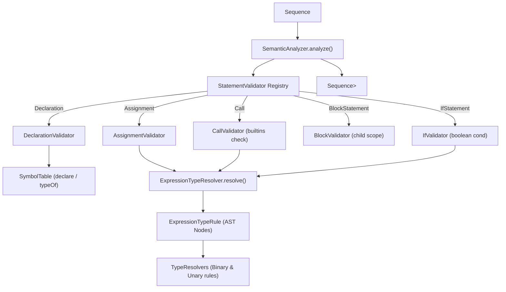

# Módulo: :semantic

**Ruta:** `/semantic`  
**Dependencias directas:** `:common`, `:ast`  
**Consumidores:** `:printscript` (perfiles v1.0 y v1.1), `:app`, `:cli`  

---

## 1. Responsabilidad y Propósito (SRP)
- **Qué problema resuelve:** Realiza la comprobación estática de tipos (*type-checking*), la verificación de alcance de identificadores (*scope checking*), previene la redeclaración de variables, asegura la inmutabilidad de constantes (`const`), valida condiciones booleanas en sentencias de control (`if`/`else`) y verifica compatibilidad en operaciones binarias, unarias y llamadas a funciones.
- **Qué hace:**
  - Valida sentencias desacopladas mediante el patrón de reglas extensibles `StatementValidator<T>` (`Declaration`, `Assignment`, `Call`, `BlockStatement`, `IfStatement`).
  - Mantiene la tabla de símbolos jerárquica (`SymbolTable`) con encadenamiento léxico hacia el padre (`parent`).
  - Resuelve recursivamente el tipo estático de cualquier expresión (`ExpressionTypeResolver`) con cero alocaciones en hot paths.
  - Verifica llamadas a funciones utilizando la abstracción compartida `BuiltinMethod` (proveniente de `:common`).
  - Provee resolvedores de tipos estándar (`TypeResolvers`: suma/concatenación, aritmética estricta, operadores unarios numéricos y lógicos `!`).
  - Emite errores semánticos puramente funcionales (`Result<T>` con `ErrorType.SEMANTIC`).
- **Qué NO hace (Fronteras):**
  - No ejecuta sentencias ni calcula valores numéricos/texto en tiempo de ejecución (responsabilidad de `:interpreter`).
  - No re-analiza sintaxis ni consume tokens directamente (responsabilidad de `:parser`).

---

## 2. Arquitectura y Componentes Clave

### Diagrama de Arquitectura


### Entidades de Dominio e Interfaces
1. **`SemanticAnalyzer`:**
   - Orquestador desacoplado: `fun analyze(statements: Sequence<Statement>): Sequence<Result<Statement>>`.
   - Despacha cada sentencia a su `StatementValidator<Statement>` registrado en un mapa de configuración, logrando simetría total con el `:interpreter` y `:parser` y eliminando cualquier bloque cerrado `when`.
   - Construible mediante `SemanticAnalyzer.builder()`.
2. **`StatementValidator<T : Statement>`:**
   - Interfaz funcional y builder: `fun validate(statement: T, context: SemanticContext): Result<Unit>`.
   - Provee validadores atómicos estándar en `StandardStatementValidators` (`declaration`, `assignment`, `call`, `block`, `ifValidator`).
   - Los conjuntos de reglas por versión (`v1_0`, `v1_1`) residen en sus respectivos perfiles en `:printscript`, manteniendo `:semantic` completamente agnóstico de la versión.
3. **`SemanticContext`:**
   - Contexto de ejecución que desacopla la validación del orquestador global. Expone `symbolTable: SymbolTable`, `expressionResolver: ExpressionTypeResolver`, `validate(Statement)`, `validateInChildScope(...)` y creación de flows con `.flow()`.
4. **`SemanticFlow`:**
   - Monad / railroad-oriented flow que encadena verificaciones e inferencias de tipos con semántica de cortocircuito (`expect`, `step`, `stepAll`, `optionalStep`, `then`, `thenResult`).
5. **`ExpressionRule<T : Expression>`:**
   - Reglas atómicas de inferencia de tipo para expresiones, construibles con `ExpressionRule.builder<T>()` y evaluadas mediante `ExpressionContext`.
6. **`SymbolTable`:**
   - Almacén de tipos válidos y variables registradas con mutabilidad. Soporta ámbitos anidados mediante `createChild()`, resolviendo variables subiendo por la cadena de padres en $O(\text{profundidad})$ sin alocaciones de memoria innecesarias.
7. **`ExpressionTypeResolver`:**
   - Infiere recursivamente el tipo estático de expresiones mediante reglas componibles `ExpressionRule<T>`. Consulta tipos de variables delegando directamente a `symbolTable::typeOf` ($O(1)$ allocations) y valida funciones contra `BuiltinMethod`.
8. **`TypeResolvers`:**
   - Reglas de compatibilidad de tipos:
     - `additionOrConcat`: `number + number = number`, `string + anything = string`.
     - `numericOnly(op)`: Operaciones aritméticas estrictas (`-`, `*`, `/`, `**`).
     - `unaryNumeric(op)`: `-` unario exige `number`.
     - `booleanNot`: `!` unario exige `boolean`.

---

## 3. Manejo de Errores y Pipeline Funcional
- **ErrorType asociado:** `ErrorType.SEMANTIC`.
- **Garantías:** Cero excepciones. Errores tales como:
  - Variable ya declarada o no declarada.
  - Tipo no reconocido.
  - Reasignación de constantes (`const`).
  - Condición no booleana en sentencias `if`.
  - Incompatibilidad de tipos en asignaciones y operaciones binarias/unarias.
  - Funciones no declaradas o funciones sin retorno (`println`) utilizadas como expresiones.
  Todos son modelados funcionalmente como `Failure("...", ErrorType.SEMANTIC)`.

---

## 4. Integración con Builtins Compartidos (`BuiltinMethod`)
El tipo `BuiltinMethod` reside en `:common` y contiene tanto la metadata semántica (`name`, `returnType`) como la ejecución para el intérprete. Esto permite que los perfiles de lenguaje (v1.0, v1.1) definan su conjunto de builtins **una única vez** y los compartan de manera idéntica entre el `SemanticAnalyzer` y el `Interpreter`.

---

## 5. Extensibilidad (Open/Closed Principle)
Para agregar una nueva sentencia (ej: `WhileStatement`):
```kotlin
// 1. Crear el validador con SemanticFlow
val whileValidator = StatementValidator.builder<WhileStatement>("while")
    .validate { stmt, ctx ->
        var condType = ""
        ctx.flow()
            .step({ ctx.resolveExpressionType(stmt.condition) }) { condType = it }
            .expect(condType == "boolean") { "La condición del 'while' debe ser de tipo 'boolean'" }
            .thenResult { ctx.validateInChildScope(stmt.body) }
    }
    .build()

// 2. Componer en el analizador mediante SemanticAnalyzer.builder()
val customAnalyzer = SemanticAnalyzer.builder()
    .withExpressionResolver(customResolver)
    .registerStatementValidator(WhileStatement::class, whileValidator)
    .build()
```
